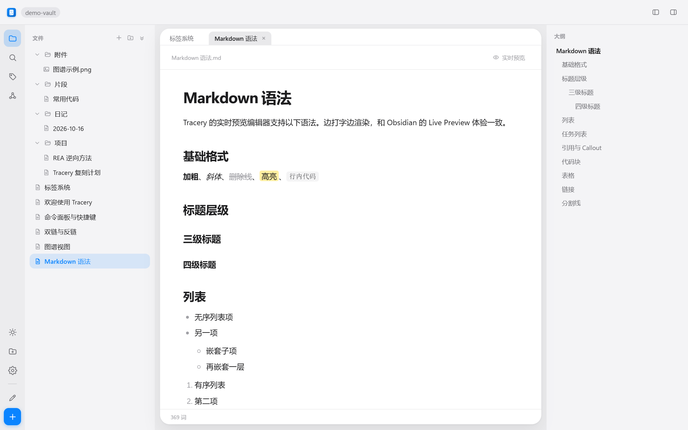

# Tracery

**开源的仓库型 Markdown 笔记软件 · Obsidian 兼容备选**

[](LICENSE)
[](/)
[](test)

一个文件夹就是一座仓库，`.md` 文件就是笔记，`[[双链]]` 把它们织成网络。
**纯 Markdown 存储，完全兼容 Obsidian 仓库** —— 拿来就能用，随时能回去。

> 这是一次 **REA（Reverse Engineer Anything）式逆向学习实践**：先用 REA 静态分析本机安装的
> Obsidian（Electron 应用、无源码、25MB ASAR），再从证据出发复刻其架构与核心体验。
> 完整报告见 **[docs/OBSIDIAN_ANALYSIS.md](docs/OBSIDIAN_ANALYSIS.md)**。



## 为什么做它

Obsidian 很好，但有四件事不舒服：同步 $4/月且服务端在海外、商用 $50/人/年、移动端必须装 App、
安装包 225MB。Tracery 的取舍是 **MIT 免费商用 + 自托管同步 + 中文优先 + 轻量**，
完整对比见 **[docs/ROADMAP.md](docs/ROADMAP.md)** · 接手开发先读 **[docs/HANDOFF.md](docs/HANDOFF.md)**。

## 功能

| 功能 | 说明 |
|---|---|
| 📂 仓库管理 | 打开任意文件夹，最近列表一键切换（标题栏仓库名 / 左下角文件夹图标） |
| ✍️ 实时预览编辑 | 边打边渲染；任务列表 / Callout / 表格 / 代码块 / 高亮 |
| 🔗 双链与反链 | `[[笔记]]` 未解析点击即创建；重命名自动更新所有引用；反链带上下文 |
| 🕸️ 图谱视图 | 力导向布局，**支持全屏查看**、缩放、适应窗口、拖拽跳转 |
| ✏️ 内置绘图 | 画笔 / 荧光笔 / 橡皮 / 撤销，画完直接插入笔记；笔画数据另存，后续可再编辑 |
| 🖼️ 图片与附件 | `![[图片.png]]`、`![[图.png\|400]]`、``；**点图看大图**（滚轮缩放/拖动） |
| 🔍 搜索与命令面板 | 全文检索；`Ctrl+P` 模糊跳转 + 执行命令 |
| 🏷️ 标签 / 大纲 | `#标签` 自动收集；标题大纲跳转 |
| 🎨 主题即配置 | 一套 CSS 变量，Apple 风 / Obsidian 风；设置面板调色并一键导出 |
| 🔄 自托管同步 | 同步到你的 NAS/服务器，或**同一 Wi-Fi 内输 6 位通行码直连**；不同段落自动合并，大附件分块续传 |
| 💾 自动保存 | 停止输入 0.9 秒落盘，外部修改实时刷新 |

## 快速开始

```bash
# 源码运行（Node 20+）
npm install && npm start          # 浏览器打开 http://localhost:9520

# 桌面窗口（与打包版一致）
npm run start:electron

# 打包 Windows exe
npm run dist:dir                  # 产出 dist/win-unpacked/Tracery.exe
```

已打包版本从 Releases 下载 zip，解压双击 **Tracery.exe**。首次启动自动打开演示仓库。

> 国内网络加镜像：`ELECTRON_MIRROR=https://npmmirror.com/mirrors/electron/`。
> 单文件 portable exe 需要符号链接权限（Windows 开发者模式）；普通账户用
> `npm run dist:dir` 生成目录，改了前端后 `npm run repack` 只重打 `app.asar`，再压缩发布。

### 常用快捷键

`Ctrl+P` 命令面板 · `Ctrl+Shift+F` 搜索 · `Ctrl+N` 新建 · `Ctrl+E` 源码/预览 ·
`Ctrl+B`/`Ctrl+I` 加粗斜体 · `Ctrl+K` 双链 · `Ctrl+Shift+D` 绘图 · `Ctrl+,` 设置 ·
`Ctrl+\` 折叠侧栏 · `Esc` 退出浮层/全屏

## 同步

### 方式一：局域网直连（最简单）

同一个 Wi-Fi 下，**不用装任何服务端**：

1. 设备 A：设置 → 同步 → 「本机当主机，生成通行码」，屏幕上出现 6 位数字
2. 设备 B：设置 → 同步 → 输入这 6 位数字 → 「查找并连接」
3. 两边自动完成首次合并，之后改完即推、定时拉取

主机关掉共享或退出应用即停止；数据只在参与同步的设备之间流动。

### 方式二：自建同步服务端（NAS / 服务器，长期多设备）

```bash
npx tracery-sync --port 9600 --data /volume1/tracery --name 家里的NAS
```

把打印出的**地址 + 配对码**填进客户端「设置 → 同步」：

- 多设备自动同步；内容寻址去重；大附件 1MB 分块上传，断点续传
- **能合就合**：两边改的不是同一段 → 自动三方合并；同一段冲突才保留两份（原文件 + `笔记 (冲突 设备名 时间).md`）
- 远端删除的文件进 `.tracery/trash/`，不直接销毁
- 服务端零业务逻辑，只存 blob + 版本清单

协议、systemd / Docker 部署、安全边界：**[sync-server/README.md](sync-server/README.md)** ·
设计细节：**[docs/SYNC.md](docs/SYNC.md)**

> 同步走 HTTP 明文，适合局域网或 Tailscale/WireGuard；端到端加密在 v3，接口已按此设计。

## 架构

照 Obsidian 的进程分工：**主进程独占文件系统与索引，渲染进程只做 UI**。

```
渲染进程（BrowserWindow / 浏览器）
  编辑器 · 文件树 · 反链/大纲/标签 · 搜索 · 命令面板 · 图谱
        │ HTTP API + WebSocket（≈ Obsidian IPC）
Node 服务端（Electron 版作为子进程）
  vault 读写 · 链接/标签索引（≈ metadataCache）· fs.watch · 同步引擎
        │
   仓库文件夹（纯 .md，随时可用别的编辑器打开）
```

| 环节 | Obsidian（REA 结论） | Tracery |
|---|---|---|
| 运行时 | Electron 主进程 + 渲染进程 | Node 服务端 + 浏览器客户端（Electron 壳可选） |
| 编辑器 | CodeMirror | contenteditable + 自研 Markdown 双向引擎 |
| 图谱 | PixiJS | Canvas 手写力导向 |
| 配置目录 | `.obsidian/` | `.tracery/` |
| 同步 | 官方付费服务 | 自托管 `sync-server/` |

想改代码：`server/server.js`（文件与索引）、`public/js/editor.js`（编辑器）、
`public/js/markdown.js`（Markdown ↔ DOM）、`public/js/app.js`（主控制器）。
主题只需改 `public/themes/*.css`，变量速查表在 [public/themes/README.md](public/themes/README.md)。

## 测试

```bash
npm run test:e2e        # 15 项：渲染 / 编辑 / 双链 / 搜索 / 图谱 / 设置
npm run test:ui         # 10 项：窗口按钮 / 主题图标 / 仓库切换
npm run test:sync       # 27 项：双实例 + 真同步服务端（合并、冲突、分块、删除、鉴权）
npm run test:sync-ui    # 11 项：同步面板 / 部署说明
npm run test:ux         # 16 项：布局 / 新建对话框 / 图片 / 图谱全屏
npm run test:merge      # 10 项：三方合并边界（同段冲突、CRLF、相邻改动）
npm run test:lan        # 10 项：局域网直连（通行码发现 / 配对 / 双向同步 / 停止）
npm run test:tabs       # 12 项：多标签页 / 栏宽拖拽 / 绘图历史
npm run test:draw       # 12 项：绘图面板 / 撤销 / 保存 PNG / 插入笔记
```

全部用无头 Edge 真实驱动，截图落在 `test/screenshots/`。同步测试会起三个进程跑真实传输。

## 已知限制

- 无插件系统（Obsidian 插件 API 完全不同，投入产出比低）
- 同步尚未做端到端加密（v3），服务端能读到明文
- 公式为等宽展示；无 Mermaid / PDF 预览
- 自研编辑器对极端嵌套格式的序列化可能不完美

## 声明

个人学习作品，UI 与交互参考 Obsidian，与 Obsidian 官方无关；二进制分析仅针对本机已安装副本，
用于技术学习。代码采用 [MIT 许可](LICENSE)。欢迎 Issue / PR，先读 [CONTRIBUTING.md](CONTRIBUTING.md)。
